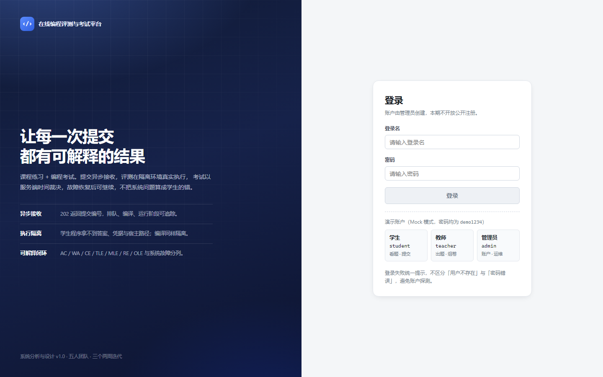
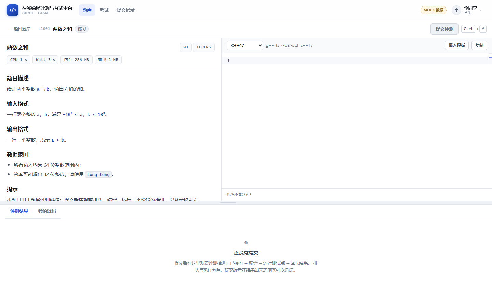
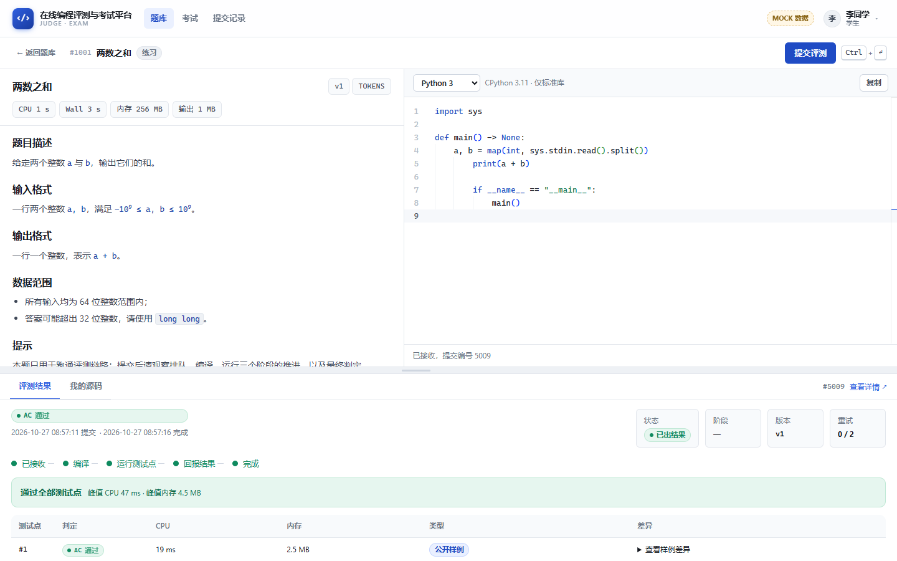
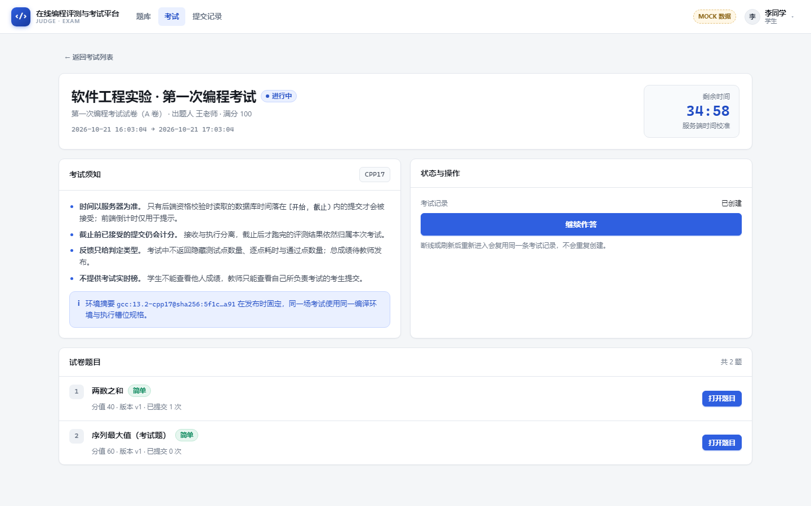
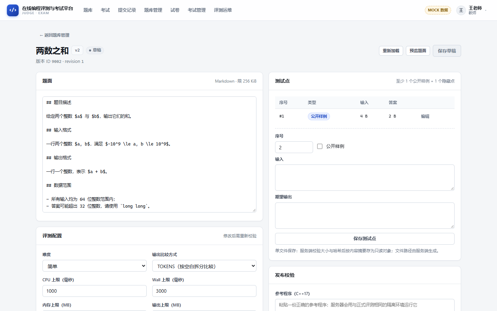
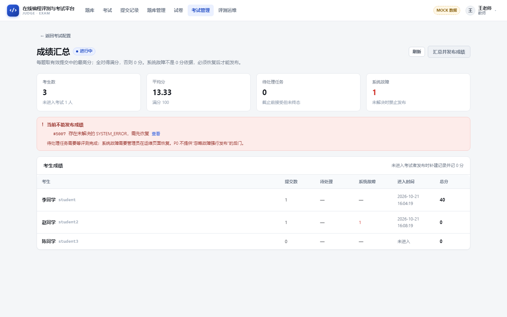
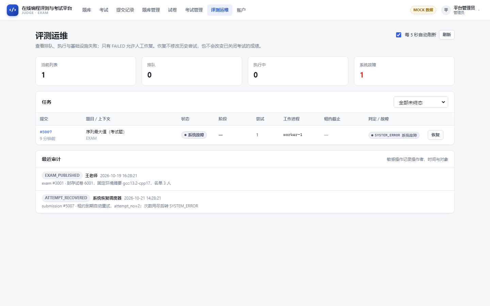
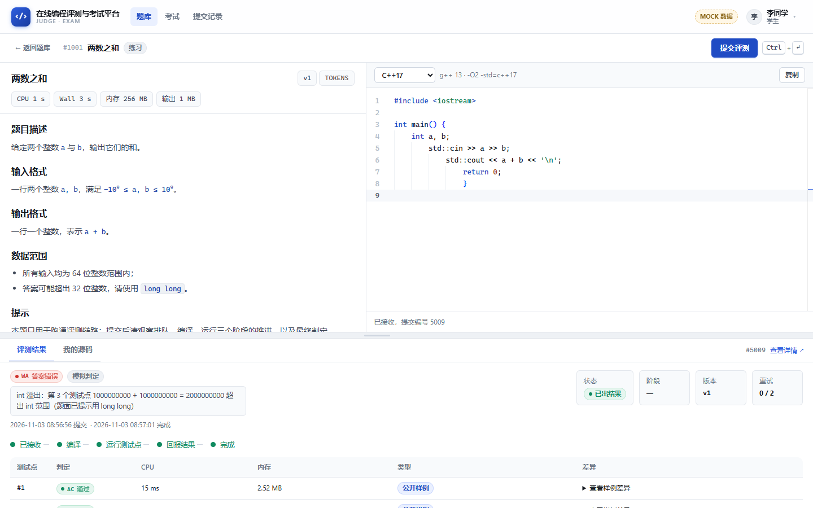

# 在线编程评测与考试平台 · 前端

依据《在线编程评测与考试平台 · 系统分析与设计（v1.0）》实现的前端工程。
技术栈与文档 §4.2 一致：**Vue 3 + TypeScript + Vite + Monaco Editor**。

设计目标不是"把后台页面铺满"，而是把文档里最容易做错的四条链路在前端表达清楚：

| 文档要求 | 前端落点 |
| --- | --- |
| 异步接收、状态可追踪（NFR-01、NFR-06） | 提交后立刻拿到编号，`排队 → 编译 → 运行 → 回报` 分阶段展示，2 秒起轮询、5 秒封顶 |
| 考试以服务端时间裁决（BR-01） | 倒计时按接口返回的 `serverTime` 校准偏移；截止后按钮禁用并显示原因，但最终由后端裁定 |
| 反馈策略隔离（BR-08、BR-12） | 练习可看 CPU/内存与公开样例差异；考试只给阶段与最终判定，不显示隐藏点数量与逐点细节 |
| 幂等与故障恢复（BR-05、BR-06、NFR-04） | 一次点击一个 `Idempotency-Key`，网络失败重试复用；`SYSTEM_ERROR` 与 WA 明确分开，提示恢复流程 |

## 界面预览

| 登录 | 做题工作台（题面 45% / 编辑器 55% / 结果在下方） |
| --- | --- |
|  |  |

| 评测结果（阶段推进 + 逐点判定） | 考试入口（服务端倒计时） |
| --- | --- |
|  |  |

| 题目版本编辑器（草稿 / 校验 / 发布） | 成绩汇总与发布 |
| --- | --- |
|  |  |



> 这些截图来自本工程的真实运行结果（Mock 数据），不是设计稿。
> 已在本地验证：`npm run typecheck` 0 错误、`npm run build` 通过、学生 / 教师 / 管理员三条主链路无控制台报错。

---

## 1. 在 VS Code 里跑起来

```bash
cd frontend
npm install
npm run dev
```

打开 <http://127.0.0.1:5173> 即可。默认 `VITE_USE_MOCK=true`，**不需要后端、不需要数据库、不需要装 MySQL/Redis**，全部页面与状态都能走通。

### 如果 PowerShell 报「因为在此系统上禁止运行脚本」

这是 Windows 执行策略拦住了 `npm.ps1`，与本项目无关。任选一种：

1. 改用 `npm.cmd`（最简单，不改系统设置）：
   ```powershell
   cd frontend
   npm.cmd run dev
   ```
2. 把 VS Code 终端切到 **Command Prompt**（终端面板 `+` 右侧下拉 → `Command Prompt`），再执行 `npm run dev`。
3. 只对当前用户放开脚本执行（不改动机器级策略）：
   ```powershell
   Set-ExecutionPolicy -Scope CurrentUser RemoteSigned
   ```

### 用 VS Code 任务启动（不敲命令）

`Terminal → Run Task… → dev`（等价于 `npm run dev`；另有 `build`、`typecheck` 两个任务）。
服务器起来后，按住 <kbd>Ctrl</kbd> 点击终端里的 `Local: http://127.0.0.1:5173/` 即可打开。

演示账户（Mock 模式，密码均为 `demo1234`）：

| 角色 | 登录名 | 能看到什么 |
| --- | --- | --- |
| 学生 | `student` | 题库、做题、提交评测、考试入口、本人成绩 |
| 教师 | `teacher` | 题目版本编辑与校验、试卷组卷、考试发布、成绩汇总发布 |
| 管理员 | `admin` | 账户管理、评测运维（查看任务 / 人工恢复 / 审计） |

建议 VS Code 安装 **Vue - Official**（Volar）扩展，仓库已在 `.vscode/` 里写好推荐扩展与 TS 设置。

### 常用命令

```bash
npm run dev        # 开发服务器（默认 5173）
npm run build      # 类型检查 + 生产构建，产物在 dist/
npm run preview    # 预览构建产物
npm run typecheck  # 只做类型检查
```

### 做题工作台的三个交互约定

1. **多语言**：编辑器右上角可切换 `C++17 / C11 / Python 3 / Java 17`（语法高亮随之切换，空代码时自动套用该语言模板）；考试中只能选发布时固定的 `allowedLanguages`，伪造其他语言会被后端 422 拒绝。
2. **单位统一用 MB**：内存上限、输出上限、峰值内存、测试点文件大小都按 MB / KB 展示；教师版本编辑器也以 MB 填写，提交时再换算成数据库的 KiB / 字节。
3. **结果区高度可拖动**：评测结果区上方有一条拖拽条 —— 鼠标上下拖动改变高度；聚焦后 `↑`/`↓` 微调（按住 Shift 步长更大）、`Enter` 或双击复位；高度记在 `localStorage`，刷新后保持。窄屏（≤1024px）自动改为上下堆叠，拖拽条隐藏。

### 在没有后端的情况下也能演示的关键状态

Mock 不是"假数据截图"，而是实现同一张接口表，并按时间推进状态：

- 提交后 1.2 秒内是 `QUEUED`，随后 `RUNNING + COMPILING`、`RUNNING + RUNNING`、`REPORTING`，约 5 秒出终态；
- 判定由 `src/api/mock.ts` 里的**演示判题器**给出（界面标有「模拟判定」），它不是随机数，而是按每道题设计的陷阱推断：
  - 编译期：缺少 `main` / 括号不匹配 / 用了 `cin` 却没 `#include` / Python 函数漏冒号 → **CE**；
  - 运行期：`while (1)` → **TLE**，`new long long[100000000]` → **MLE**，`return 1/0` → **RE**，输出超量 → **OLE**；
  - 逻辑：没读输入、没做加法、用 `int` 收 1e9+1e9（第 3 个隐藏点溢出）→ **WA** 并给出可读原因；
  - 每题还会按题意判断：区间求和缺前缀和 → O(n·q) **TLE**，LIS 用双层循环 → O(n²) **TLE**；
- 教师端"发起校验"后 4 秒自动从 `VALIDATING` 转 `READY`（或失败回 `DRAFT`），可完整走通 草稿 → 校验 → 发布；
- 考试 3001 正在进行、3002 已发布成绩、3003 尚未开始，分别对应可作答 / 只看成绩 / 不泄露题面三种状态。

直接复制下面几段到「两数之和」，就能分别看到四种判定（FT-12 的错误程序集）：

| 想看 | 提交这段 |
| --- | --- |
| AC | `long long a, b; std::cin >> a >> b; std::cout << a + b;` |
| WA（int 溢出） | 同上，但把 `long long` 换成 `int` |
| CE | 删掉最后一行的 `}` |
| TLE | 循环里写 `while (1) {}` |

> 说明：前端没有 C++ 编译器，演示判题器只覆盖上面这些可推断的情形；换成真实后端后（`VITE_USE_MOCK=false`），判定完全由 worker + sandbox 执行给出，界面上的「模拟判定」标记会自动消失。



---

## 2. 和后端对接（不影响其他人已写好的部分）

前端只通过一个环境变量决定请求去哪，**没有硬编码地址、没有跨域假设**：

```bash
# .env.local
VITE_USE_MOCK=false
VITE_API_BASE_URL=/api/v1
VITE_DEV_PROXY_TARGET=http://127.0.0.1:8080   # 仅开发期 Vite 代理用
```

约定：

1. **同源 Cookie 会话**，`fetch` 带 `credentials: 'same-origin'`；写请求自动附带 `X-CSRF-Token`（从 `csrf_token` / `XSRF-TOKEN` Cookie 读取，也可用 `setCsrfToken()` 注入）。
2. **统一错误结构**：后端返回 `{ code, message, requestId }`，前端归一化为 `ApiError`，UI 按 401/403/404/409/422/429/503 给出不同文案。
3. **ID 一律字符串**（避免 JS 大整数失真），**时间一律带 Z 的 ISO-8601**，界面统一转 `Asia/Shanghai` 展示。
4. **前端不传**题面版本、满分、环境摘要等由服务端裁决的字段。
5. `public` 目录无内容、无 `base` 假设，反向代理把 SPA 与 `/api` 同源提供即可（文档 §9.1 第 6 步）。

### 接口清单（与文档 §6.1 一一对应）

| 方法 | 路径 | 说明 |
| --- | --- | --- |
| POST | `/auth/login` | 登录，返回用户概要并设置会话 |
| POST | `/auth/logout` | 撤销当前会话 |
| GET | `/me` | 当前用户 + `serverTime` |
| GET | `/problems` | 公开练习题列表（分页、关键词、难度） |
| GET | `/problems/{id}` | 题面 + 题目版本 + 公开样例 |
| POST | `/submissions` | 正式提交，需 `Idempotency-Key`，返回 202 |
| GET | `/submissions` | 本人历史（教师按自己考试过滤） |
| GET | `/submissions/{id}` | 阶段、判定、允许的反馈 |
| GET | `/exams`、`/exams/{id}` | 考试列表 / 概要（未开始不返回题面） |
| POST | `/exams/{id}/enter` | 幂等创建或取得考试记录 |
| GET | `/exams/{id}/problems/{problemId}` | 解析试卷中的固定版本 |
| GET | `/exams/{id}/my-grade` | 本人分题成绩（`CLOSED` 后） |
| POST | `/teacher/problems`、`/teacher/problems/{id}/versions` | 建题 / 建新草稿版本 |
| GET/PUT | `/teacher/problem-versions/{id}` | 读取 / 保存草稿（`revision` 乐观锁，过期 409） |
| POST | `/teacher/problem-versions/{id}/cases` | 单文件上传测试点（input / expected） |
| POST | `/teacher/problem-versions/{id}/validate` | 用参考程序发起校验，版本转 `VALIDATING` |
| POST | `/teacher/problems/{id}/publish` | 指定 READY 版本为题目入口 |
| GET/POST | `/teacher/papers`；PUT `/teacher/papers/{id}/items` | 组卷（整卷替换，需 `revision`） |
| POST | `/teacher/exams`；PUT `/teacher/exams/{id}/members` | 建考试草稿、替换名单 |
| POST | `/teacher/exams/{id}/publish`、`/cancel` | 校验 + 封存 + 发布；开始前可取消 |
| GET/POST | `/teacher/exams/{id}/grades`、(…)/grades/publish | 成绩汇总与发布（有阻塞项时 409） |
| GET | `/admin/judge/tasks` | 任务队列视图（不返回源码与隐藏数据） |
| POST | `/admin/submissions/{id}/recover` | 仅 FAILED，需原因与幂等键 |
| POST/PATCH | `/admin/users`、`/admin/users/{id}/status` | 创建账户、停用/启用 |

### 为完成页面补充的 4 个只读接口

文档 §6.1 的接口表没有覆盖"教师在自己的工作台上打开已有草稿/查看可选版本/挑学生"这几步，前端补了 4 个**只读**接口。后端实现时可自由调整命名，只需同步改 `src/api/client.ts` 一处：

| 方法 | 路径 | 用途 |
| --- | --- | --- |
| GET | `/teacher/problems` | 教师本人题目列表（含 `latestVersionId`，用于进入版本编辑器） |
| GET | `/teacher/ready-versions` | 组卷时可选的全部 READY 版本 |
| GET | `/teacher/students` | 导入名单时可勾选的学生账户 |
| GET | `/teacher/exams/{id}/publish-check` | 发布前的校验结果（阻塞项列表），便于提前展示 |

这些接口都只返回教师自己有权限看到的数据；不加它们也能工作，只是教师需要手动输入 ID。

---

## 3. 目录结构

```
frontend/
├─ index.html
├─ vite.config.ts          # 只做别名/代理/端口，不含业务逻辑
├─ .env.development        # 默认 Mock 模式
├─ .env.production         # 生产构建关闭 Mock
├─ src/
│  ├─ main.ts / App.vue
│  ├─ router/index.ts      # 路由 + 角色守卫（仅体验层，不是安全边界）
│  ├─ api/
│  │  ├─ types.ts          # 接口 DTO（ID 字符串、时间 ISO-8601）
│  │  ├─ http.ts           # 前缀、CSRF、错误归一化、Mock 开关
│  │  ├─ client.ts         # 一处一个函数的类型化封装
│  │  └─ mock.ts           # 开发期假后端：实现同一张接口表
│  ├─ stores/              # auth（会话 + 服务端时间偏移）、toast
│  ├─ composables/         # usePolling（2s→5s 退避）、useCountdown（服务端时间）
│  ├─ components/          # AppShell、CodeEditor(Monaco)、MarkdownView、判定/状态徽章…
│  ├─ views/
│  │  ├─ LoginView / ProblemListView / WorkbenchView
│  │  ├─ ExamListView / ExamEntryView / MyGradeView
│  │  ├─ SubmissionListView / SubmissionDetailView
│  │  ├─ teacher/          # 题库、版本编辑器、试卷、考试、成绩
│  │  └─ admin/            # 账户、评测运维
│  ├─ utils/               # 时间/字节格式化、草稿、UUID
│  └─ styles/base.css      # 设计变量与通用组件类
└─ docs/                   # 交付说明（可选）
```

**和别人的模块怎么共存**：这个目录是自包含的 SPA，只依赖 `/api/v1` 的 HTTP 契约。后端、worker、数据库、部署都在各自目录里，前端不引入任何服务端代码；如果小组用 `contracts/` 存放共享协议，把 `src/api/types.ts` 视为前端侧视图即可，字段名保持一致就能对接。

---

## 4. 关键实现说明（对应文档规则）

### 4.1 提交幂等（§4.8.1、BR-05）
`WorkbenchView.onSubmit` 每次用户点击生成一个 UUID；网络异常时保留同一个键，页面出现"用同一幂等键重试"；收到 202 后立即清空，下次点击换新键。后端只要保证 `UNIQUE(user_id, idempotency_key)` 并比较 `request_hash`，就能得到"同载荷重试返回同一编号、异载荷 409"的行为。

### 4.2 轮询与退避（NFR-06、ADR-06）
`usePolling` 默认 2 秒，连续轮询时每次 ×1.25 并封顶 5 秒；服务端可通过响应里的 `pollAfterMs` 建议间隔，前端取较大值。进入 `FINISHED/FAILED`、切换路由、组件卸载、页面不可见（`visibilitychange`）都会停止或暂停；重新可见时立刻补一次。

### 4.3 考试倒计时（BR-01）
`auth.syncServerTime(serverTime)` 把 `服务端时间 - 本地时间` 记为偏移，所有倒计时都用 `Date.now() + offset` 计算。倒计时到 0 只代表"界面认为已截止"，按钮禁用并显示原因；能否提交仍由后端在接收事务里用数据库时间判定（`409 EXAM_ENDED` 会原样显示）。

### 4.4 考试反馈策略（BR-08、BR-12）
`SubmissionDetail` 的 `cases` 在考试上下文中被服务端过滤；前端在考试页面直接不渲染逐点表格，只显示阶段与最终判定。`policyNote` 用于解释"为什么看不到细节"。

### 4.5 草稿（§6.3）
`localStorage` 键为 `judge.draft.{userId}.{practice|exam-<id>}.{problemVersionId}`，恢复时给出提示条与"清除草稿"；退出登录清理该用户全部草稿。草稿只用于恢复编辑内容，不被当作提交证据。

### 4.6 安全渲染（§6.3）
`MarkdownView` 先整体转义 HTML，再套用有限语法（标题、列表、引用、代码块、粗体、http(s) 链接），因此题面里的 `<script>`、`onerror=` 只会显示为文本；链接强制 `rel="noopener noreferrer"`。代码编辑器里的源码永远以纯文本渲染。

### 4.7 教师端状态机（BR-03、BR-04）
版本编辑器把 `DRAFT → VALIDATING → READY` 做成了显式 UI：`VALIDATING` 与 `READY` 都禁用编辑并说明原因；保存带 `revision`，收到 409 时提示"页面数据已过期"并自动重新加载；"发起校验"会把参考程序保存到本地，方便反复校验同一份代码。

---

## 5. 尚未实现 / 有意留白（与文档一致）

| 项目 | 文档依据 | 前端处理 |
| --- | --- | --- |
| 运行样例（P1） | §6.3"在 P1 前不显示可点击的空功能" | 不渲染按钮，不占位 |
| SSE 状态推送（P1） | ADR-06 P0 只做轮询 | 只实现轮询，接口隔离在 `api/client.ts`，后续替换成本低 |
| 考试实时榜 | BR-12 不开发 | 无入口 |
| 多语言 / 函数签名题 | §1.3 P2 | 语言选择固定 `CPP17`，UI 上以只读 chip 呈现 |
| 成绩 CSV 导出、同版本重评 | §6.1 P1（"不预先实现空接口"） | 不实现、不显示灰按钮 |

## 6. 验收自查清单（对应文档 §8.4）

- [x] 未登录访问任意页面 → 跳登录页，登录后回到原路径
- [x] 空代码提交 → 前端提示"代码不能为空"，不发起请求；后端 422 也会原样展示
- [x] 同一次点击产生的重试共用幂等键；换一次点击换新键
- [x] 提交后 2 秒内看到"排队中"，随后阶段推进，终态停止轮询
- [x] 刷新页面后仍能看到上次提交并继续轮询（会话内）
- [x] 考试未开始时看不到题面；截止后提交按钮禁用并说明原因
- [x] 考试提交只显示判定类型，不显示逐点数据
- [x] 教师端 409（revision 过期）提示"页面数据已过期"，并重新加载
- [x] 只有 FAILED 才能人工恢复，且恢复原因必填
- [x] 有系统故障时成绩发布按钮可见但发布被拒绝，并列出阻塞提交

> 以上为前端行为自查；真实评测、隔离、恢复时间的验收仍须按文档在 Linux 环境实测，Mock 不能替代。
